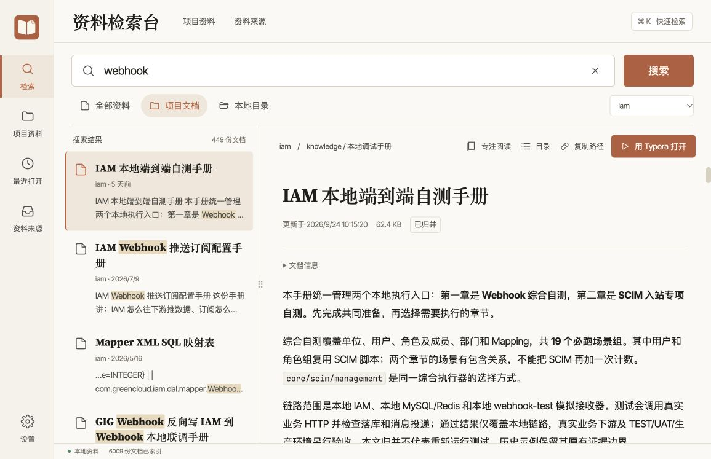

# kb-dashboard · 资料检索台

把项目文档和本地目录放到一个检索入口：查关键词、筛项目、看正文，再回到本地编辑器继续工作。支持浏览器和 Electron 桌面窗口。



## 使用

- 输入关键词即可检索，`⌘K` / `Ctrl+K` 聚焦搜索。结果按相关度排列，支持项目、来源筛选和分页。
- 左侧结果默认占约 30%。拖动分隔线调整宽度；双击或按 Enter 恢复默认；左右方向键微调。比例保存在本机。
- 项目资料使用目录树：文件夹原位展开、折叠，支持多分支同时展开和状态记忆；点击文件在右侧预览。左右键展开或收起，上下键选择，Enter 打开，支持全部折叠。
- 正文支持 Markdown、SQL、代码高亮、Mermaid、图片、目录跳转和专注阅读。浏览器前进、后退可恢复选中文档。
- “最近打开”保留本机阅读记录；右键可移除记录。“设置”可调整字号、密度、主题和启动时恢复阅读。
- “资料来源”支持连接、改名、移除本地目录。移除来源只修改连接配置，原文件保留。
- 文件在磁盘上更新后，当前预览自动刷新。搜索结果会提示更新，由用户刷新；本地服务断开时会显示状态并尝试重连。

学习项目和 Obsidian 已退出默认入口、索引和监听。旧链接会跳回检索台并说明停用状态，原目录和已有软链保留。需要检索其中的文件时，可在“资料来源”重新连接对应目录。

## 启动

```bash
./start.sh        # 检查项目文档软链、安装依赖、启动前后端
```

也可手动运行：

```bash
npm install
npm run dev      # 前端 5173，API 5174
npm run app      # 前后端及 Electron 窗口
```

访问 [本地检索台](http://127.0.0.1:5173)。默认项目资料软链为 `data/work → ~/work/code/sanwan/notes`，路径不同时修改 `start.sh` 的 `WORK_TARGET`。其他本地目录从界面连接，配置保存在 `~/.kb-dashboard/custom-sources.json`。

如果已有桌面应用占用 5174，可分别启动独立预览：

```bash
PORT=5274 npm run dev:api
KB_API_PORT=5274 npm run dev:web -- --host 127.0.0.1 --port 5273
```

## 开发与验证

| 命令 | 用途 |
| --- | --- |
| `npm test` | 状态解析、摘要、SSE 恢复及临时目录 API 回归 |
| `npm run build` | 构建前端到 `dist/` |
| `npm run dist` | 构建并打包到 `release/` |
| `npm run preview-design` | 在 5180 查看归档设计稿 |

API 测试仅使用临时目录和回环端口，不修改用户资料。手动测试来源管理时，可用 `KB_DATA_DIR` 指定临时数据根目录、`KB_CONFIG_DIR` 指定临时配置目录；两者都应隔离。

首次搜索时建立索引。单个超过 1.5 MB 的文件默认不参与全文索引；自定义目录超过 1200 个可读文件时仅支持浏览，界面会提示。超过 5 MB 的文本文件提示用本地编辑器打开，避免预览卡顿。这些阈值分别可用 `KB_SEARCH_MAX_FILE_BYTES`、`KB_SEARCH_MAX_CUSTOM_FILES_PER_MOUNT`、`KB_PREVIEW_MAX_FILE_BYTES` 调整。

修改源码后，已运行的桌面应用仍使用旧构建。需要单独执行 `npm run dist` 并重新启动新构建，改动才会在桌面版生效。

## 页面与兼容链接

检索台统一使用 `/`，查询、范围、目录和当前文档保存在 URL 参数中。`/work`、`/custom`、`/search`、`/prefs` 保留跳转兼容；`/learn` 和 `/obsidian` 显示停用说明。Electron 的 `file:` 页面使用 HashRouter。

## 文件操作边界

读取、索引和预览均不改原文件。现有右键“移到废纸篓”仍需用户确认，仅将单个文件或目录移入 macOS 系统废纸篓；禁止删除来源根目录和自定义挂载根，不提供永久或批量删除。

`design-preview/` 是历史设计归档。旧页面文件暂时保留作兼容参考，不再作为默认功能加载。技术结构见 [CLAUDE.md](CLAUDE.md)。

## 改动记录

**v1.5 — 右键移到系统废纸篓**
- 四源文件树和最近打开列表支持右键“移到废纸篓”，覆盖文件与目录
- 后端新增 `POST /api/file/trash`，只接收 `source + path`，经 `safeResolve` 后调用 macOS 系统废纸篓
- 禁止删除来源根目录和 custom 挂载根目录；不提供永久删除

**v1.4 — Electron 打包实际可用 + 链接智能跳转**
- `npm run dist` 真正产出可双击的 `.app`
- 修了一串连环坑：Vite `base: './'`（file:// 下绝对路径 404）/ `directories.output: 'release'`（和 vite dist 分离）/ `asarUnpack` server + 核心 node_modules（ESM 加载器在 asar 内有兼容问题）/ preload 注入 `window.__KB_API_BASE__`
- `will-navigate` 兜底：非本地 URL 全走 `shell.openExternal`，file:// 跳转一律阻止，再不白屏
- Markdown 链接接管（`processLinks`）：5 档识别 — http / 锚点 / 绝对源路径 / 相对 md / **镜像仓库兜底**（`/<project>/md/codex/...` 自动映射到 work 源）

**v1.3 — Prefs 真配置 + 学习打卡 + Obsidian 图谱 + 分包 + 跨页后退**
- `useTheme` / `usePrefs` 用 `useSyncExternalStore` 共享状态，所有组件即时同步
- Prefs 页：主题 3 档 / 密度 3 档 / 字号滑块 / 4 项行为开关 / 源开关 / 键盘快捷键 / 诊断重置
- 学习打卡：`parseProgress` 扫 `### YYYY-MM-DD` 记录 → streak + 30 天热图
- Obsidian 局部图谱：径向 SVG（入链紫 / 出链蓝 / 双向橙），点击跳转
- Vite `manualChunks`：拆 React / hljs 独立，主 bundle 从 1.18MB 砍到 ~76KB
- `selectedPath` 改成 `useSearchParams`，浏览器前进后退能恢复选中文件

**v1.2 — 文件热更新 + 代码高亮 + Mermaid + 图片嵌入**
- `chokidar` 监听三源 → `/api/events` SSE 广播 → 前端自动重拉当前文件
- 5s 防抖批量重建搜索 + Obsidian 索引
- `highlight.js` 代码块高亮 + 自定义 Claude 风暗底
- `mermaid` 动态 `import()`（~600KB 懒加载）
- `/api/blob` 二进制代理，`![[image.png]]` 真实显示

**v1.1 — 深色主题 + Markdown TOC + 文件树过滤**
- CSS 变量 + `[data-theme="dark"]` 覆盖 17 个变量
- MarkdownView 扫 h2/h3 自动加 id，右侧 sticky TOC，滚动高亮
- Obsidian / Work / Learn 侧栏顶部加过滤 input

**v1.0 — 搜索 + Obsidian 反链/标签 + 一键启动**
- minisearch 索引 ~800 篇 md，中英混合分词（英文前缀+模糊，中文按字 AND）
- ⌘K 浮层搜索（debounce + 键盘导航 + 按源分组）
- `server/lib/obsidian-index.js` 扫 `[[wikilink]]` + `#tag`，严格正则排除 `##heading`
- 反链面板 + 标签面板接入前端
- `start.sh` 一键启动；`.gitignore` 排除 `data/` 软链

**v0.5 — 四页全接真实数据**
- `/api/learn/progress`：progress.md 阶段表格 + 断点段结构化解析
- `/api/home/overview`：fast-glob 递归扫三源 + PARA/项目分组
- 抽共享 `ReaderPanel.jsx`（MarkdownView / Empty / Loading / Error）
- Home / Obsidian / Work / LearnSpacious 全部消费真 API
- Home 所有卡片 `<Link>` 化

**v0.4 — 后端骨架就绪**
- Fastify + CORS + `node --watch`
- `data/` 下三个软链 + `safeResolve` 路径穿透防护
- 核心端点：`/api/sources` `/api/tree` `/api/file` `/api/health`
- `marked` + `gray-matter` + wikilink/embed 占位
- Vite `/api` proxy → :5174

**v0.3 — 剩余 4 页迁移**
- Obsidian / Work / Search / Prefs 从 `design-preview/` 全迁入
- 删除 Stub 占位，路由 6 条全真

**v0.2 — 工程化改造**
- Vite 5 + React 18 + React Router 6 脚手架
- 原静态稿全部搬入 `design-preview/` 归档
- `primitives.jsx` 改 ES module，TopBar 接 NavLink
- 两页先行：Home（上下三段） + LearnSpacious（呼吸感版）

**v0.1 — 静态设计稿**
- Claude design 产出 9 个页面变体，`design-preview/` 归档，`npm run preview-design` 能看

## License

MIT — 详见 [LICENSE](LICENSE)。
